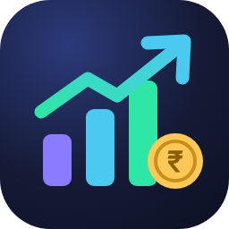
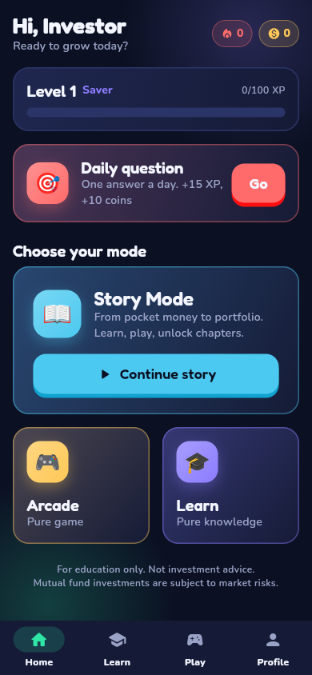
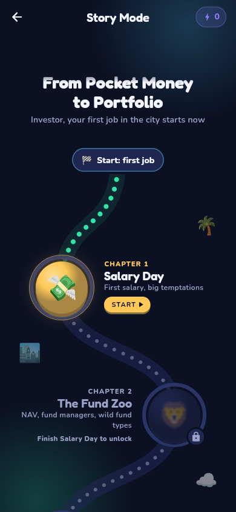
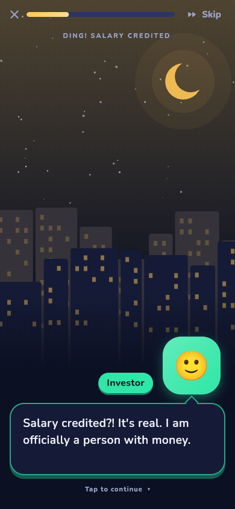
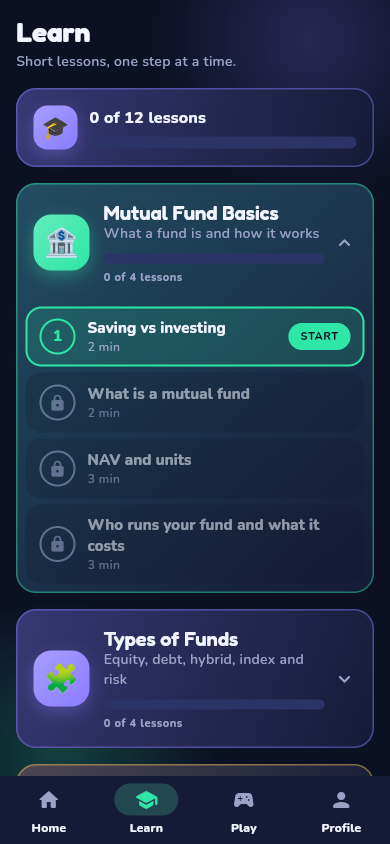
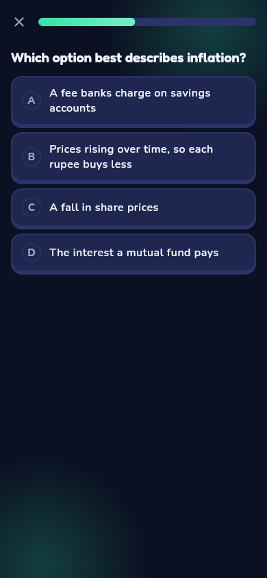
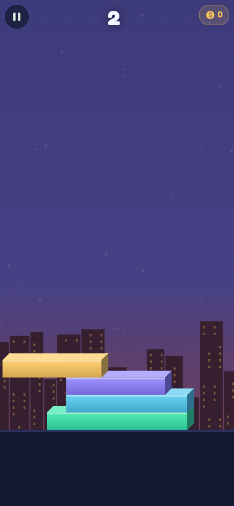
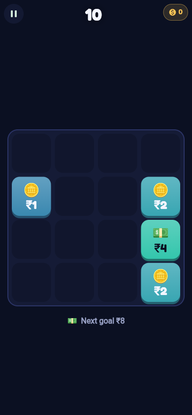

<p align="center"></p>

# Investor Game

Learn how mutual funds work by playing. Three modes share one profile, one economy and one question bank:

| Mode | What it is |
|---|---|
| **Story** | "From Pocket Money to Portfolio": three chapters of dialogue, lessons, games and decisions |
| **Arcade** | Pure games. Answer a question mid-run for a power-up, or to revive once |
| **Learn** | Pure education: 3 modules, 12 lessons, 60 questions in five formats |

<p>





</p>
<p>



</p>

## Try it

Android: download the APK from the latest [release](../../releases) and install it (allow installs from your browser when asked). Releases are signed with a debug key, for testing only.

From source:

```bash
flutter pub get
flutter test
flutter run            # or: flutter run -d chrome
```

## How it is built

Flutter, Flame (games), Riverpod (state), go_router (navigation). No image or audio assets: every visual is drawn in code.

```
lib/
  core/        theme tokens, shared widgets, profile store, content repo, cloud backup, router
  domain/      plain data types (questions, lessons, game config and result)
  features/
    home_hub/  shell, home, daily question
    content/   Learn tab, lesson player, QuestionView (mcq, true/false, myth/fact, match, scenario)
    games/     _shared (ArcadeGame base, GameHostScreen, registry), runner, stack, merge
    story/     chapter map, chapter steps, dialogue, reward
    profile/
assets/content/  modules.json (lessons and questions), story.json (chapters)
```

- **Adding a game:** extend `ArcadeGame`, add one entry to `games_registry.dart`. The host supplies the HUD, pause, boost questions, revive and results.
- **Adding content:** edit `assets/content/modules.json`. `test/widget_test.dart` validates every question.
- **Player data** is stored on the device. When online, the app signs in anonymously to Firebase and backs the profile up to Firestore (`users/{uid}`), using REST calls in `lib/core/cloud.dart`.

## Releases

Pushing a branch named `release/vX.Y.Z` builds the APK and publishes a GitHub Release with that tag.

## Known limits

- The finance content is a draft. It needs review by a subject-matter expert and a compliance reviewer before any public launch.
- Rewards are computed on the device, so scores are not cheat-proof. Server-side validation needs Cloud Functions.
- Anonymous accounts only: progress does not move between devices yet.
- Not yet built: iOS release, sound, Hindi and other languages, light theme.

Plans: [roadmap](docs/ROADMAP.md), [5-hour execution plan](docs/EXECUTION_PLAN.md).

*For education only. Not investment advice. Mutual fund investments are subject to market risks.*
